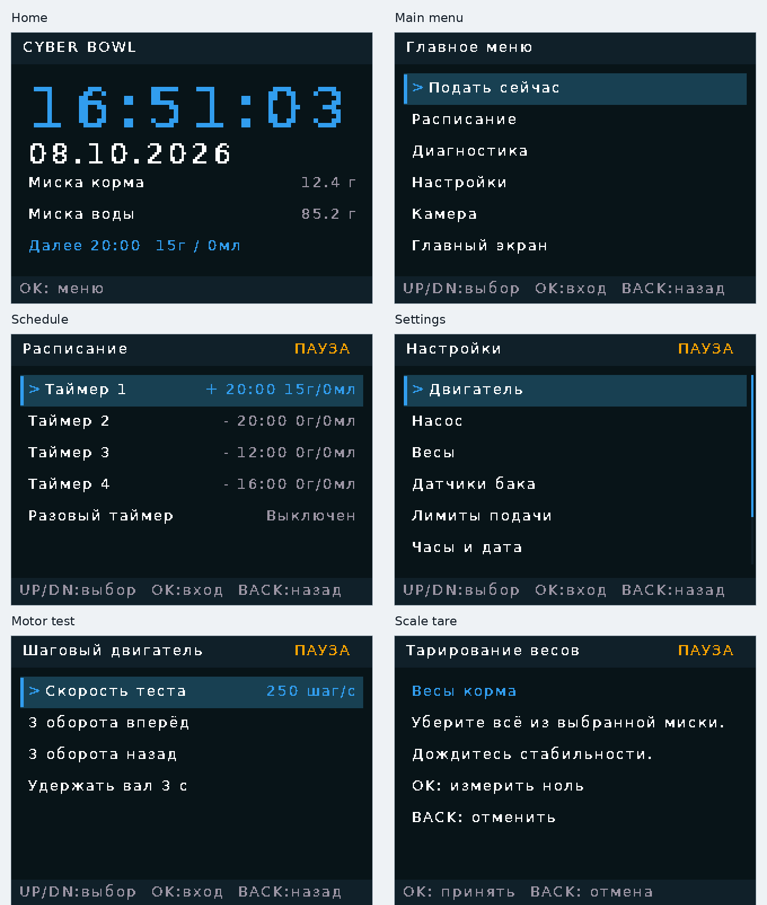
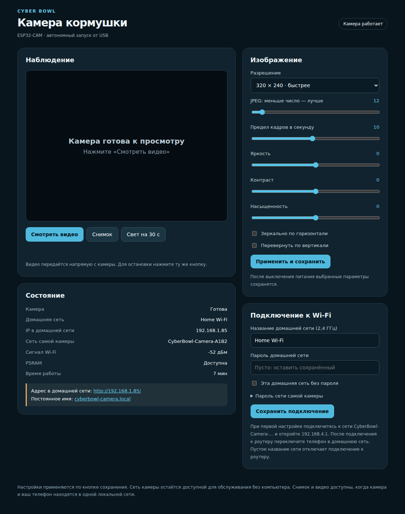
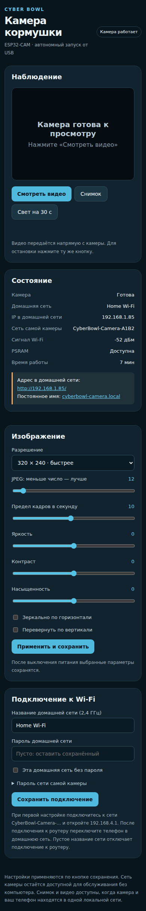

# Cyber-Bowl

**Самый лучший телеграмм канал — [@KlavaOrKormushka](https://t.me/KlavaOrKormushka)**

Cyber-Bowl — проект автоматической кормушки для домашних животных. Система состоит из основного контроллера кормления и отдельного модуля камеры. Контроллер управляет подачей корма и воды, измеряет их количество весами и предоставляет управление через TFT-дисплей и кнопки. Камера передаёт изображение в браузер по Wi-Fi.

В качестве референса использовался [CatFeeder2](https://github.com/altJSV/CatFeeder2), этот проект построен на ESP32, сенсорном ILI9341 и LVGL, а Cyber-Bowl — отдельная реализация на ESP32-S3 с кнопочным интерфейсом, двумя весовыми каналами, отдельным насосом и камерой.

## Электронные компоненты Cyber-Bowl

| Узел | Компонент | Назначение |
|---|---|---|
| Основной контроллер | ESP32-S3 DevKitC-1 | Управление кормлением, датчиками, часами и дисплеем |
| Локальный интерфейс | TFT 2,8″ ST7789, четыре кнопки UP/DOWN/OK/BACK | Главное меню, ручной запуск, диагностика и настройки |
| Часы | DS3231 RTC | Текущее время и выполнение расписания при перезапусках контроллера |
| Весы миски корма | Тензодатчик с HX711 | Измерение выданного корма и остановка шнека по целевому весу |
| Весы миски воды | Тензодатчик с HX711 | Измерение прироста массы воды в миске |
| Наличие корма | ИК-датчик KY-032 | Контроль корма в бункере |
| Наличие воды в баке | Аналоговый датчик уровня, вход ADC | Двоичный признак «вода есть/нет» |
| Подача корма | Шаговый двигатель NEMA 17 17HS4401 и драйвер A4988 | Вращение шнека |
| Подача воды | DC-насос 12 В и MOSFET-ключ | Включение насоса по команде контроллера |
| Камера | Отдельная плата ESP32-CAM AI Thinker с OV2640 | Передача фото и видеопотока по Wi-Fi |
| Питание | Блок 12 В, 3 А; преобразователи DC-DC LM2596 и XL4015 | Питание узлов проекта от общей силовой части |


## Возможности проекта

- ручная подача корма и воды, отдельно или последовательно в одном цикле;
- ежедневное расписание и разовый таймер;
- остановка выдачи корма по показаниям весов миски;
- контроль порции воды по изменению веса миски с ограничением времени работы насоса;
- защита от отсутствия корма в бункере, пустого бака, потери показаний весов и переполнения миски;
- диагностика датчиков и проверочные режимы двигателя и насоса;
- сохранение пользовательских настроек во flash-памяти ESP32.

Модуль камеры предоставляет отдельный просмотр видео и снимка, собственную сеть Wi-Fi для первоначальной настройки, подключение к домашнему роутеру и настройки изображения из браузера.

## Состав репозитория

| Путь | Назначение |
|---|---|
| `firmware/` | Прошивка основного контроллера кормушки для ESP32-S3 |
| `firmware/docs/display/` | Кадры интерфейса |
| `cyber_bowl_camera/` | Отдельная прошивка модуля ESP32-CAM |
| `cyber_bowl_camera/docs/` | Примеры веб-интерфейса камеры на компьютере и телефоне |
| `3d_models/` | 3D-модели проекта |

## Основная прошивка кормушки

### Плата и сборка

Проект настроен в PlatformIO на плату `esp32-s3-devkitc-1`, framework Arduino и C++17. Основной конфигурационный файл находится в `firmware/platformio.ini`.

Откройте папку `firmware` как проект PlatformIO. Сборка без загрузки на плату:

```bash
cd firmware
pio run
```

Загрузка собранной прошивки выполняется отдельно:

```bash
pio run -t upload --upload-port PORT
```

Замените `PORT` на порт платы, например `/dev/ttyACM0` в Linux/WSL или `COM7` в Windows.

### Основной цикл

`firmware/src/main.cpp` инициализирует насос, таймер двигателя, хранилище настроек, датчики, RTC, контроллер процессов и интерфейс. В каждом проходе `loop()` прошивка обрабатывает кнопки, обновляет датчики и часы, выполняет текущую операцию, проверяет расписание и обновляет дисплей. Генерацию импульсов STEP выполняет аппаратный таймер ESP32, поэтому она не зависит от частоты перерисовки экрана.

### Структура прошивки

| Файл или группа                                                      | Назначение                                                                 |
| -------------------------------------------------------------------- | -------------------------------------------------------------------------- |
| `include/pins.hpp`                                                   | Назначение GPIO основного контроллера                                      |
| `include/settings.hpp`, `src/settings.cpp`                           | Структура настроек, значения по умолчанию и проверка допустимых диапазонов |
| `include/config_store.hpp`, `src/config_store.cpp`                   | Хранение настроек во flash, версия формата                                 |
| `include/button.hpp`, `src/button.cpp`                               | Чтение кнопок, устранение дребезга и повторы при удержании                 |
| `include/auger.hpp`, `src/auger.cpp`                                 | Управление STEP/DIR/ENABLE шнекового двигателя аппаратным таймером         |
| `include/pump.hpp`, `src/pump.cpp`                                   | Включение и выключение насоса                                              |
| `include/sensors.hpp`, `src/sensors.cpp`                             | Два HX711, датчик наличия корма, аналоговый датчик воды и показания весов  |
| `include/clock.hpp`, `src/clock.cpp`                                 | Работа с RTC DS3231                                                        |
| `include/feeding_controller.hpp`, `src/feeding_controller.cpp`       | Ручные циклы, дозирование, расписание, проверки и обработка ошибок         |
| `include/ui.hpp`, `src/ui.cpp`                                       | Инициализация интерфейса и обработка кнопок                                |
| `src/ui_menu.cpp`, `src/ui_edit.cpp`, `src/ui_render.cpp`            | Содержимое меню, редактирование значений и отрисовка страниц               |
| `include/ui_font.hpp`, `src/ui_font.cpp`, `include/ui_font_data.hpp` | Вывод встроенного шрифта и таблицы его символов                            |

### Управление кнопками

| Кнопка | Действие |
|---|---|
| UP / DOWN | Перемещение по меню или изменение значения |
| Удержание UP / DOWN | Повтор изменения после задержки повтора |
| OK | Открыть пункт, принять значение или запустить выбранную операцию |
| BACK | Вернуться назад или отменить редактирование |
| BACK во время процесса | Остановить двигатель и насос, завершить текущий цикл |

### Главное меню и экран

Главный экран показывает крупные часы, дату, вес в миске корма и воды, ближайшее событие расписания и подсказку для входа в меню.

В главном меню доступны подача сейчас, расписание, диагностика, настройки и справочная страница камеры. В ручной подаче можно изменить порцию корма в граммах и воды в миллилитрах, затем запустить выдачу одного компонента или обоих.



### Подача корма и воды

Для корма контроллер запоминает вес в миске перед запуском, прибавляет заданную порцию и задаёт полученную величину как цель. Шнек работает до достижения этой цели. Дополнительно проверяются доступность показаний весов, наличие корма в бункере, лимит миски и таймаут подачи. 

Для воды контроллер запоминает исходный вес миски. Запрошенный объём в миллилитрах сравнивается с приростом массы в граммах. Насос останавливается по достижении цели, при заполнении миски или по временному ограничению. Время рассчитывается по сохранённому расходу насоса в мс/мл; если к этому моменту весы зарегистрировали менее 90% порции, контроллер сообщает об ошибке. 

Ошибки недействительных или устаревших показаний весов, пустого бака и переполнения останавливают активаторы. Для весов используется таймаут актуальности показаний 2 секунды. Работа насоса ограничена максимальным временем, заданным в настройках.

### Расписание

- Поддерживаются четыре ежедневных таймера. Заводские часы таймеров — 08:00, 20:00, 12:00 и 16:00; все они изначально выключены.
- В каждом таймере задаются включение, время, порция корма в граммах и воды в миллилитрах.
- Нулевая порция корма позволяет задать только воду, нулевая порция воды — только корм. Включённый таймер не может иметь обе порции равными нулю.
- Разовый таймер задаётся задержкой от 1 минуты до 7 суток и собственными порциями.
- Ближайшее запланированное событие и его порции показываются на главном экране.

## Камера

Камера — отдельный модуль ESP32-CAM с OV2640. Для неё используется отдельная прошивка, настройки, Wi-Fi и NVS; управление кормлением выполняет основной контроллер ESP32-S3.





### Подключение к камере

При запуске камера создаёт собственную точку доступа вида `CyberBowl-Camera-XXXX`, где окончание формируется из MAC-адреса платы. Пароль точки доступа по умолчанию — `bowl-camera`. Подключитесь к этой сети и откройте адрес точки доступа, напечатанный в последовательном мониторе; обычно это `http://192.168.4.1/`.

На веб-странице можно ввести SSID и пароль домашней сети. Точка доступа камеры остаётся активной и после настройки роутера. При потере соединения камера повторяет подключение каждые 30 секунд. При подключении в домашней сети адрес можно посмотреть в интерфейсе/статусе или открыть `http://cyberbowl-camera.local/`, если mDNS поддерживается клиентским устройством.

### Возможности веб-интерфейса камеры

- просмотр MJPEG-потока и получение отдельного JPEG-снимка;
- настройка домашней сети, пароля точки доступа и выбора открытой сети;
- разрешения 320 × 240, 640 × 480 и 800 × 600; без обнаруженной PSRAM доступно только 320 × 240;
- регулировка JPEG-качества, предела кадров в секунду, яркости, контраста и насыщенности;
- зеркальное отражение и переворот изображения;
- включение встроенного белого светодиода; после включения он автоматически гаснет через 30 секунд и всегда выключен при старте;
- диагностика состояния камеры, PSRAM, Wi-Fi, IP-адресов, уровня сигнала, времени работы, света и сохранения настроек.

Настройки изображения и Wi-Fi сохраняются в NVS отдельного модуля камеры. Страница написана на русском и встроена в прошивку; внешние CDN для неё не требуются.

Основная страница и API обслуживаются по HTTP на порту 80. MJPEG-поток доступен на порту 81 по пути `/stream`; отдельный JPEG-снимок — по пути `/snapshot`. Статус и управление предоставляются через `/api/status`, `/api/image`, `/api/wifi` и `/api/light`.

### Структура прошивки камеры

| Файл или группа                        | Назначение                                                                      |
| -------------------------------------- | ------------------------------------------------------------------------------- |
| `include/camera_pins.hpp`              | Распиновка AI Thinker ESP32-CAM с OV2640; независима от распиновки кормушки     |
| `include/config.hpp`, `src/config.cpp` | Модель, заводские значения и сохранение настроек камеры в NVS                   |
| `src/config_validation.cpp`            | Проверка допустимых диапазонов настроек                                         |
| `src/camera_driver.cpp`                | Инициализация камеры, PSRAM, настройки изображения, получение кадра и светодиод |
| `src/network.cpp`                      | Точка доступа, домашний Wi-Fi, повторное подключение и mDNS                     |
| `src/web_server.cpp`                   | HTTP API, JPEG-снимок, MJPEG и серверы управления/потока                        |
| `src/web_ui.cpp`                       | HTML-страница камеры                                                            |
| `src/form_codec.cpp`                   | Проверка и декодирование параметров веб-форм                                    |
| `src/main.cpp`                         | Инициализация модулей и основной цикл                                           |

### Сборка камеры

Конфигурация PlatformIO находится в `cyber_bowl_camera/platformio.ini`. Она использует среду `camera`, плату `esp32cam` и framework Arduino.

```bash
cd cyber_bowl_camera
pio run
```

Загрузка на камеру:

```bash
pio run -t upload --upload-port PORT
```


